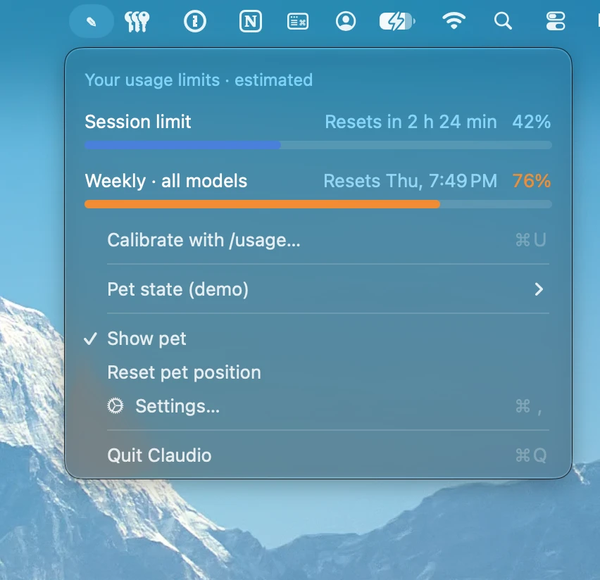
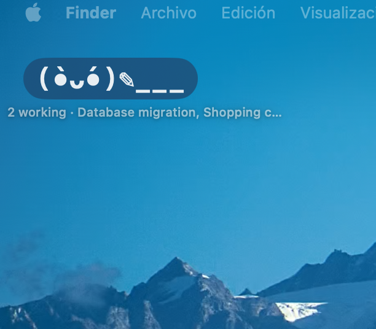

<div align="center">


```
(◕‿◕)   (◑_◑)   (•̀ᴗ•́)✎__   (ﾉ◕‿◕)ﾉ !   (⊙_⊙) ?
```

# Claudio

**Una mascota ASCII para tu escritorio que te avisa cuando Claude termina, y tus límites de uso en la barra de menús de macOS.**


[](https://github.com/melikslab/claudio/actions/workflows/build.yml)

*English summary [below](#english).*

</div>

---

Claudio vigila los chats de **Claude Code** en la app de escritorio de Claude (pestaña Code), en el terminal o en el IDE. Una mascota flotante muestra en todo momento qué está haciendo Claude: cuando piensa, trabaja, termina o te necesita. Al terminar, la mascota salta con un **¡!** y un globito con lo último que ha dicho y las respuestas que te propone. Un clic te lleva directamente a ese chat.

> [!NOTE]
> **🍎 Solo para Mac.** Pensada para Macs con chip Apple (M1 o posterior) y macOS 14 Sonoma o superior. Para Macs con Intel hay una descarga aparte. No hay versión para Windows ni Linux.

> [!IMPORTANT]
> **🔒 100 % local. Nada va a la nube.** Claudio obtiene todos los datos de ficheros que ya están en tu Mac. No se conecta a internet, no inicia sesión en ninguna cuenta, no envía telemetría y no lee credenciales. Los detalles están en [Privacidad](#privacidad).

## Capturas

<p align="center">
  
</p>
<p align="center"><em>Un chat ha terminado: la mascota avisa con un «!» y el globito muestra lo último que ha dicho Claude y las respuestas que propone. Un clic en una opción la copia y abre ese chat.</em></p>

<table>
  <tr>
    <td align="center" width="50%"></td>
    <td align="center" width="50%"></td>
  </tr>
  <tr>
    <td align="center"><em>Clic en el icono: límites de uso de 5 h y semanal (en naranja al acercarse al tope).</em></td>
    <td align="center"><em>Al pasar el ratón: tus últimos chats y qué está haciendo cada uno.</em></td>
  </tr>
  <tr>
    <td align="center"></td>
    <td align="center"></td>
  </tr>
  <tr>
    <td align="center"><em>Mientras Claude trabaja, con los chats activos debajo.</em></td>
    <td align="center"><em>En reposo, esperando al siguiente chat.</em></td>
  </tr>
</table>

<sub>Los chats de las capturas son de ejemplo.</sub>

## Funciones

### 🐾 Mascota flotante
- Siempre encima de las ventanas, visible en todos los escritorios y a pantalla completa.
- Se arrastra libremente por todo el escritorio, en cualquier pantalla, y recuerda la posición. Si desconectas un monitor y se queda fuera, vuelve sola a la vista.
- El texto de debajo ("Pensando… · nombre del chat") se desplaza hacia dentro si la mascota está pegada a un borde.
- Cada estado tiene su animación ASCII:

  | Estado | Animación |
  |---|---|
  | En reposo | `(◕‿◕)`, parpadea cada 6 s |
  | Pensando | `(○_○)` → `(◔_◔)` → `(◑_◑)` → `(◕_◕)` → `(●_●)`: los ojos se van llenando |
  | Trabajando / escribiendo | `(•̀ᴗ•́)✎___` |
  | Terminado | `(ﾉ◕‿◕)ﾉ !` |
  | Te necesita (permiso o pregunta) | `(⊙_⊙) ?` |
  | Dormida (15 min sin actividad; clic para despertarla) | `(−_−) zZz` |

### 💬 Globito con respuestas rápidas
- Cuando un chat termina, aparece un globito con **el principio del último mensaje** (4 líneas como máximo) y la pregunta, si la hay.
- Muestra **las respuestas que propone Claude**: los botones de fin de turno de la app, las opciones de `AskUserQuestion` o, si no hay, una lista final con pregunta.
- **Clic en una opción:** se copia al portapapeles y se abre ese chat concreto (`claude://code/continue?session=…`). Solo tienes que pegar y pulsar Enter.
- **Clic en el globito o en la mascota:** abre el chat.
- Si el globito no cabe encima de la mascota, se coloca solo debajo, a la derecha o a la izquierda.
- **Al cerrarlo con la ✕** deja de llamar la atención: la mascota vuelve al reposo hasta que ese chat cambie de estado.
- **Al entrar en la app de Claude** se quitan todos los globitos y avisos pendientes, también los del Centro de notificaciones. Si ya estabas dentro cuando el chat termina, el globito se ve 6 segundos y se desvanece solo.
- Varios chats a la vez: hasta 3 globitos apilados, un contador naranja y la lista de los que siguen trabajando.

### 📊 Límites de uso en la barra de menús
- **Al hacer clic** en el icono: barras como las del panel de Claude para el **límite de sesión (5 h)** y el **semanal**, con su hora de reinicio. Son azules, pasan a **naranja desde el 70 %** y a **rojo desde el 90 %**. Debajo están la calibración y los ajustes.
- **Al pasar el ratón:** tus últimos chats con su estado. Un clic abre cualquiera.

### 🔔 Avisos
- Sonido y notificación del sistema, configurables por separado para "terminado" y "te necesita".
- Por defecto: sin sonido al terminar y **Pop** cuando pide permiso.
- Opción de avisar solo si la app de Claude no está delante. Al pulsar la notificación se abre el chat.

### 🌍 Idioma
En español si tu Mac está en español; en inglés en cualquier otro idioma.

### ⚙️ Ajustes
Abrir al iniciar el Mac, mostrar u ocultar la mascota, sonidos, notificaciones y botón de prueba.

## Instalación

**Requisitos:** un Mac con macOS 14 Sonoma o superior y la [app de escritorio de Claude](https://claude.ai/download) con la pestaña Code, o Claude Code en el terminal o en el IDE.

### Descargar
1. Descarga de la [última release](https://github.com/melikslab/claudio/releases/latest) el zip de tu Mac y descomprímelo:
   - **`Claudio-AppleSilicon.zip`** para Macs con chip Apple (M1, M2, M3…). Es la versión principal.
   - **`Claudio-Intel.zip`** para Macs con Intel. Es una app aparte, porque las versiones recientes de macOS ya solo funcionan en Apple Silicon.
2. Mueve `Claudio.app` a **Aplicaciones**.
3. La app no está firmada con un certificado de Apple Developer, así que la primera vez macOS la bloquea. Ábrela con **clic derecho → Abrir**, o quita la cuarentena:

```bash
xattr -dr com.apple.quarantine /Applications/Claudio.app
```

### Compilar desde el código
Solo hacen falta las Command Line Tools de Xcode (no Xcode completo):

```bash
git clone https://github.com/melikslab/claudio.git
```

```bash
cd claudio && ./build-app.sh && open build/Claudio.app
```

`build-app.sh` compila en modo release con SwiftPM para Apple Silicon, monta el paquete `.app` (sin icono en el Dock) y lo firma ad hoc. Para la versión Intel, `./build-app.sh --intel` genera una app aparte en `build/intel/Claudio.app`.

## Calibrar el uso

Claude no guarda en disco tu % de uso y no hay una API pública para leerlo sin iniciar sesión. Por eso Claudio **lo estima**:

1. Escribe `/usage` en cualquier chat de la app de Claude.
2. En Claudio, abre **Calibrar con /usage…** (en el menú del icono, o ⌘U con el menú abierto) y copia los dos % y las horas de reinicio.
3. Con eso Claudio calcula a cuánto gasto equivale el 100 % y, desde ahí, va sumando lo que gastan tus chats.

**Cómo sigue sola:** el reinicio semanal es fijo y avanza de 7 en 7 días; la ventana de 5 h empieza con tu primer mensaje tras el reinicio anterior.

> [!NOTE]
> Lo que gastes en claude.ai, en el móvil o en otro ordenador no aparece en este Mac, así que la estimación puede quedarse corta. Recalibra cuando notes que no cuadra; con una vez al día suele bastar.

## Cómo funciona

| Qué | De dónde lo lee |
|---|---|
| Estado de cada chat abierto (`busy` / `idle`, esperando permiso) | `~/.claude/sessions/*.json`, el registro de sesiones de Claude Code |
| Pensando o trabajando, último mensaje y respuestas propuestas | La cola de `~/.claude/projects/*/<sessionId>.jsonl` |
| Título de cada chat, chats dormidos, id para el enlace directo | `~/Library/Application Support/Claude/claude-code-sessions/**/*.json` |
| Gasto para la estimación de uso | Uso de tokens de cada respuesta en `~/.claude/projects/**/*.jsonl`, leído de forma incremental y ponderado por modelo y tipo de token |

```
Sources/Claudio/
├── main.swift             Arranque y modos de depuración (--dump, --parse, --usage, --calibrate)
├── AppDelegate.swift      Monta todo y abre chats con el enlace claude://
├── SessionMonitor.swift   Detecta chats y estados; extrae último mensaje y opciones
├── Pet.swift              Mascota ASCII, globitos y ventana flotante
├── StatusBar.swift        Icono de la barra de menús, desplegable y menú
├── UsageEstimator.swift   Estimación de uso de 5 h y semanal
├── UsageViews.swift       Barras de uso y ventana de calibración
├── Notifier.swift         Sonidos y notificaciones
└── Settings.swift         Ventana de ajustes y abrir al iniciar el Mac
```

### Depuración

```bash
build/Claudio.app/Contents/MacOS/Claudio --dump
```

| Opción | Qué hace |
|---|---|
| `--dump` | Lista los chats detectados con su estado, resumen y opciones |
| `--parse <fichero.jsonl>` | Muestra lo que saldría en el globito para ese historial |
| `--usage` | Imprime la estimación de uso actual |
| `--calibrate <%5h> <reinicio5h> <%semanal> <reinicioSemanal>` | Calibra sin abrir la ventana; las fechas van en ISO 8601, p. ej. `2026-10-26T13:10:00Z` |

## Privacidad

**Todo ocurre en tu Mac. Claudio no envía ni recibe nada por internet.**

- **Sin red:** el código no usa `URLSession`, `WebKit` ni ninguna otra API de red, y el ejecutable no enlaza esos frameworks. Puedes comprobarlo así:

  ```bash
  grep -rnE "URLSession|WKWebView|NWConnection|https?://" Sources
  ```

- **Sin cuentas:** no inicia sesión en claude.ai ni en Anthropic, y no lee credenciales, tokens ni el llavero de macOS.
- **Solo lectura:** lee los ficheros que Claude ya guarda en local (ver [Cómo funciona](#cómo-funciona)) y nunca los modifica. Tampoco toca `~/.claude/settings.json`.
- **Uso calculado en local:** el % de uso no se descarga. Se estima con el historial local y lo calibras tú escribiendo los números de `/usage`.
- **Sin telemetría:** no hay analíticas, informes de errores ni comprobación de actualizaciones.
- **Dónde guarda lo suyo:** los ajustes, la calibración y la posición de la mascota se guardan en las preferencias de macOS de la app (`~/Library/Preferences/com.melikslab.claudio.plist`).
- **Lo único que sale de la app** son las notificaciones del sistema, que gestiona macOS en local, y el enlace `claude://` que abre el chat en la app de Claude de tu propio Mac.

## Limitaciones

- Solo ve los chats de **Claude Code** (pestaña Code de la app, CLI o IDE). Los chats normales de claude.ai no se guardan en local.
- No puede escribir en el chat por ti: la app de Claude no tiene ninguna vía para eso. Por eso las opciones se copian al portapapeles y se abre el chat.
- Depende del formato interno de los ficheros de Claude Code, que puede cambiar entre versiones.
- El uso es una estimación (ver [Calibrar el uso](#calibrar-el-uso)).

## Hoja de ruta

- [ ] Mascota con imágenes o sprites animados en lugar de ASCII
- [ ] Firma y notarización para no tener que quitar la cuarentena

## Créditos

Inspirado en [Claudoscope](https://github.com/cordwainersmith/Claudoscope) de cordwainersmith (MIT), del que toma la idea de leer el estado de Claude Code desde `~/.claude`. Claudio es una reimplementación mucho más sencilla y no reutiliza su código.

Claudio es un proyecto independiente; no está afiliado a Anthropic.

## Licencia

[MIT](LICENSE) © melikslab

---

<a id="english"></a>

### English

<p align="center"></p>

**Claudio** is a tiny **macOS-only** menu bar app (macOS 14+, built for Apple Silicon; a separate Intel build is available) with a draggable ASCII desktop pet that watches your Claude Code chats: the Code tab of the Claude desktop app, the CLI or an IDE. The pet animates while Claude is thinking or working. When Claude finishes, it pops up a bubble with the start of the last reply and the reply options Claude suggested. Clicking an option copies it and jumps straight to that chat.

Clicking the menu bar icon shows Claude-style bars for your 5-hour and weekly limits. They turn orange at 70 % and red at 90 %. Hovering lists your latest chats. The usage is **estimated** from local chat history and calibrated by hand from `/usage`, so Claudio needs no login.

**🔒 100 % local: nothing goes to the cloud.** Claudio only reads files that are already on your Mac. It makes no network calls, sends no telemetry, reads no credentials and needs no changes to your Claude configuration. Build it with `./build-app.sh` (Command Line Tools only). MIT licensed.
