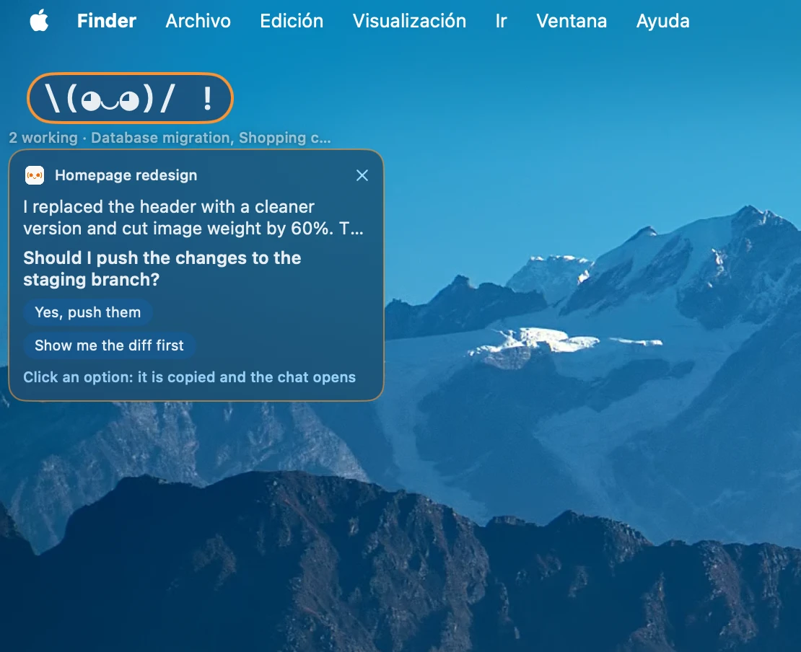
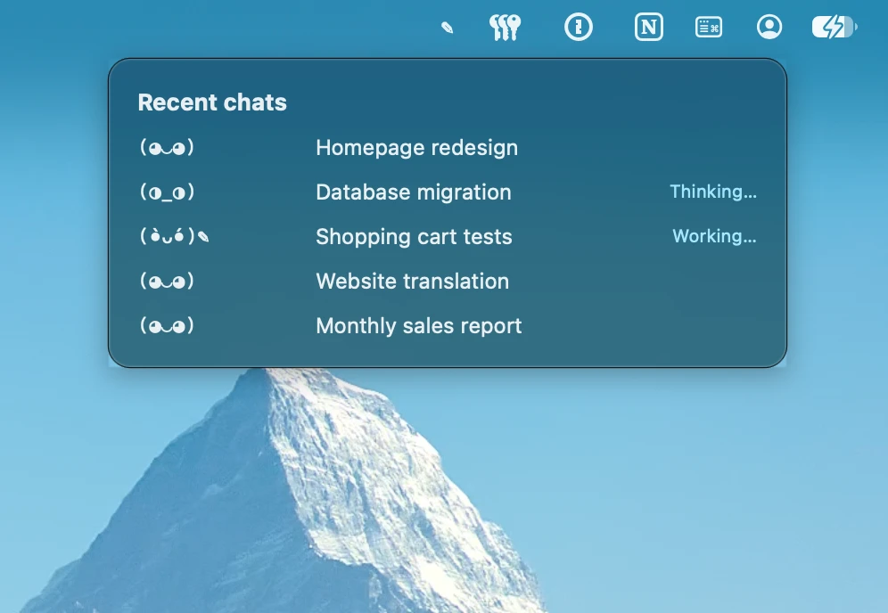
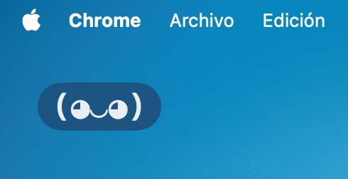

<div align="center">


```
(◕‿◕)   (◑_◑)   (•̀ᴗ•́)✎__   (ﾉ◕‿◕)ﾉ !   (⊙_⊙) ?
```

# Claudio: a desktop companion for Claude Code

**A macOS menu bar app and floating ASCII desktop pet that tells you when Claude Code finishes, shows its last reply and suggested answers, and tracks your 5-hour and weekly usage limits. 100% local.**


[](https://github.com/melikslab/claudio/actions/workflows/build.yml)

[English](README.md) · **[Español](README.es.md)**

</div>

---

Claude Code often works for minutes on its own. **Claudio** lets you look away without missing the moment it's done. It watches your Claude Code chats in the **Claude desktop app (Code tab)**, the **CLI** or your **IDE**. A small pet on your desktop shows what Claude is doing: thinking, working, done or waiting for you. When a chat finishes, the pet jumps with a **!** and a bubble shows the start of Claude's last reply and the answers it suggests. Click an answer and it's copied to the clipboard and that chat opens, ready to paste.

> [!NOTE]
> **🍎 macOS only.** Built for Apple Silicon Macs (M1 or later) running macOS 14 Sonoma or newer. A separate Intel build is available. There is no Windows or Linux version.

> [!IMPORTANT]
> **🔒 100% local. Nothing goes to the cloud.** Claudio only reads files that are already on your Mac. It never connects to the internet, never signs in to any account, sends no telemetry and reads no credentials. See [Privacy](#privacy).

## Screenshots

<p align="center">
  
</p>
<p align="center"><em>A Claude Code chat just finished: the pet shows a "!" and the bubble shows Claude's last reply and suggested answers. Click one to copy it and open that chat.</em></p>

<table>
  <tr>
    <td align="center" width="50%"></td>
    <td align="center" width="50%"></td>
  </tr>
  <tr>
    <td align="center"><em>Click the menu bar icon: 5-hour and weekly usage limits, orange as you get close.</em></td>
    <td align="center"><em>Hover the icon: your recent chats and what each one is doing.</em></td>
  </tr>
  <tr>
    <td align="center"></td>
    <td align="center"></td>
  </tr>
  <tr>
    <td align="center"><em>While Claude works, with the active chats underneath.</em></td>
    <td align="center"><em>Idle, waiting for the next chat.</em></td>
  </tr>
</table>

<sub>The chats in the screenshots are sample data.</sub>

## Features

### 🐾 Floating desktop pet
- Always on top, on every Space and in full screen.
- Drag it anywhere on any display; it remembers where you left it. If you unplug a monitor, it comes back into view.
- The caption underneath ("Thinking… · chat name") shifts inward when the pet sits at a screen edge.
- An ASCII animation for every state:

  | State | Animation |
  |---|---|
  | Idle | `(◕‿◕)`, blinks every 6 s |
  | Thinking | `(○_○)` → `(◔_◔)` → `(◑_◑)` → `(◕_◕)` → `(●_●)`, the eyes fill up |
  | Working / writing | `(•̀ᴗ•́)✎___` |
  | Done | `(ﾉ◕‿◕)ﾉ !` |
  | Needs you (permission or question) | `(⊙_⊙) ?` |
  | Asleep (15 min without activity; click to wake it) | `(−_−) zZz` |

### 💬 Reply bubble with suggested answers
- When a chat finishes, a bubble shows **the start of Claude's last message** (4 lines at most) and its question, if any.
- It lists **the answers Claude suggests**: the app's end-of-turn buttons, `AskUserQuestion` options or, failing that, a closing list with a question.
- **Click an answer:** it's copied to the clipboard and that exact chat opens (`claude://code/continue?session=…`). Just paste and press Enter.
- **Click the bubble or the pet:** opens the chat.
- If the bubble doesn't fit above the pet, it moves below, to the right or to the left.
- **Close it with ✕** and the pet stops asking for attention until that chat changes state.
- **Switch to the Claude app** and every pending bubble and notification clears. If you're already there when a chat finishes, the bubble fades out after 6 seconds.
- Several chats at once: up to 3 stacked bubbles, an orange counter and the list of chats still working.

### 📊 Claude usage limits in the menu bar
- **Click** the icon: Claude-style bars for the **5-hour session limit** and the **weekly limit**, with reset times. Blue, **orange from 70%** and **red from 90%**.
- **Hover** the icon: your recent chats with their state. Click any to open it.

### 🔔 Notifications and sounds
- Sound and system notification, set separately for "done" and "needs you".
- Defaults: no sound when done, **Pop** when Claude asks for permission.
- Optionally alert only when the Claude app isn't in front. Clicking the notification opens the chat.

### 🌍 Language
English, or Spanish if your Mac is set to Spanish.

### ⚙️ Settings
Open at login, show or hide the pet, sounds, notifications and a test alert.

## Installation

**Requirements:** a Mac with macOS 14 Sonoma or newer, plus the [Claude desktop app](https://claude.ai/download) with the Code tab, or Claude Code in the terminal or an IDE.

### Download
1. From the [latest release](https://github.com/melikslab/claudio/releases/latest), download the installer for your Mac:
   - **`Claudio-AppleSilicon.dmg`** for Apple silicon Macs (M1, M2, M3…). This is the main build.
   - **`Claudio-Intel.dmg`** for Intel Macs. It's a separate app, since recent macOS versions only run on Apple Silicon.
2. Open the DMG and **drag Claudio onto the Applications folder**.
3. The app isn't signed with an Apple Developer certificate, so macOS blocks it the first time. Open it with **right-click → Open**, or remove the quarantine flag:

```bash
xattr -dr com.apple.quarantine /Applications/Claudio.app
```

### Build from source
Only the Xcode Command Line Tools are needed, not full Xcode:

```bash
git clone https://github.com/melikslab/claudio.git
```

```bash
cd claudio && ./build-app.sh && open build/Claudio.app
```

`build-app.sh` builds a release with SwiftPM for Apple Silicon, assembles the `.app` bundle (no Dock icon) and signs it ad hoc. `./build-app.sh --intel` builds the separate Intel app in `build/intel/Claudio.app`. `scripts/make-dmg.sh` (or `scripts/make-dmg.sh --intel`) then wraps it in the drag-to-Applications DMG installer.

## Calibrating the usage estimate

Claude doesn't store your usage percentage on disk, and there's no public API to read it without signing in. So Claudio **estimates** it:

1. Type `/usage` in any chat of the Claude app.
2. In Claudio, open **Calibrate with /usage…** from the menu bar icon (or press ⌘U with the menu open) and enter both percentages and reset times.
3. Claudio works out how much spending equals 100% and from then on adds up what your chats use.

**How it keeps up on its own:** the weekly reset is fixed and rolls over every 7 days. The 5-hour window starts with your first message after the previous reset.

> [!NOTE]
> Usage from claude.ai, your phone or another computer isn't visible on this Mac, so the estimate can run low. Recalibrate when it looks off; once a day is usually enough.

## How it works

| What | Where it's read from |
|---|---|
| Each open chat's state (`busy` / `idle`, waiting for permission) | `~/.claude/sessions/*.json`, Claude Code's session registry |
| Thinking or working, last message and suggested answers | The tail of `~/.claude/projects/*/<sessionId>.jsonl` |
| Chat titles, sleeping chats, the id for the direct link | `~/Library/Application Support/Claude/claude-code-sessions/**/*.json` |
| Spending for the usage estimate | Token usage of each reply in `~/.claude/projects/**/*.jsonl`, read incrementally and weighted by model and token type |

```
Sources/Claudio/
├── main.swift             Startup and debug modes (--dump, --parse, --usage, --calibrate)
├── AppDelegate.swift      Wires everything up and opens chats via claude://
├── SessionMonitor.swift   Detects chats and states; extracts the last message and options
├── Pet.swift              ASCII pet, bubbles and floating windows
├── StatusBar.swift        Menu bar icon, hover panel and menu
├── UsageEstimator.swift   5-hour and weekly usage estimate
├── UsageViews.swift       Usage bars and calibration window
├── Notifier.swift         Sounds and notifications
├── Settings.swift         Settings window and open at login
└── Lang.swift             English / Spanish interface text
```

### Debugging

```bash
build/Claudio.app/Contents/MacOS/Claudio --dump
```

| Option | What it does |
|---|---|
| `--dump` | Lists detected chats with their state, summary and options |
| `--parse <file.jsonl>` | Shows what the bubble would display for that history |
| `--usage` | Prints the current usage estimate |
| `--calibrate <%5h> <reset5h> <%weekly> <resetWeekly>` | Calibrates without the window; dates in ISO 8601, e.g. `2026-10-26T13:10:00Z` |

## Privacy

**Everything happens on your Mac. Claudio sends and receives nothing over the internet.**

- **No network:** the code uses no `URLSession`, `WebKit` or any other networking API, and the binary doesn't link those frameworks. Check it yourself:

  ```bash
  grep -rnE "URLSession|WKWebView|NWConnection|https?://" Sources
  ```

- **No accounts:** it never signs in to claude.ai or Anthropic and reads no credentials, tokens or Keychain items.
- **Read-only:** it reads files Claude already keeps locally (see [How it works](#how-it-works)) and never modifies them. It doesn't touch `~/.claude/settings.json` either.
- **Usage computed locally:** your usage percentage isn't downloaded. It's estimated from local history and calibrated by you with the numbers from `/usage`.
- **No telemetry:** no analytics, crash reports or update checks.
- **Its own data:** settings, calibration and the pet's position live in the app's macOS preferences (`~/Library/Preferences/com.melikslab.claudio.plist`).
- **The only things that leave the app** are system notifications, handled locally by macOS, and the `claude://` link that opens the chat in the Claude app on your own Mac.

## FAQ

**How do I get notified when Claude Code finishes?**
Run Claudio. When any Claude Code chat finishes or needs your permission, the pet reacts, a bubble appears and, if you want, a macOS notification and sound go off.

**Does it work with the Claude desktop app?**
Yes, with the **Code tab** of the Claude desktop app, as well as Claude Code in the terminal and in IDEs. Regular claude.ai chats aren't stored locally, so Claudio can't see them.

**Can Claudio reply to Claude for me?**
No. The Claude app offers no way for other apps to type into a chat. Claudio copies the answer you pick and opens the right chat, so you just paste and press Enter.

**Does it need my Claude account or API key?**
No. It never signs in and reads no credentials. Usage limits are estimated locally and calibrated with `/usage`.

**Is the usage percentage exact?**
It's an estimate based on your local chats, calibrated with the real numbers from `/usage`. Usage from other devices isn't visible, so recalibrate from time to time.

**Does it work on Windows or Linux?**
No. Claudio is a native macOS app.

## Limitations

- It only sees **Claude Code** chats (Code tab of the app, CLI or IDE), not regular claude.ai chats.
- It can't type into a chat for you; answers are copied to the clipboard and the chat opens.
- It relies on Claude Code's internal file formats, which can change between versions.
- Usage is an estimate (see [Calibrating the usage estimate](#calibrating-the-usage-estimate)).

## Roadmap

- [ ] Pet with animated images or sprites instead of ASCII
- [ ] Signing and notarization, so there's no quarantine to remove

## Credits

Inspired by [Claudoscope](https://github.com/cordwainersmith/Claudoscope) by cordwainersmith (MIT), which showed the idea of reading Claude Code's state from `~/.claude`. Claudio is a much simpler reimplementation and doesn't reuse its code.

Claudio is an independent project and is not affiliated with or endorsed by Anthropic. Claude and Claude Code are trademarks of Anthropic.

## License

[MIT](LICENSE) © melikslab
